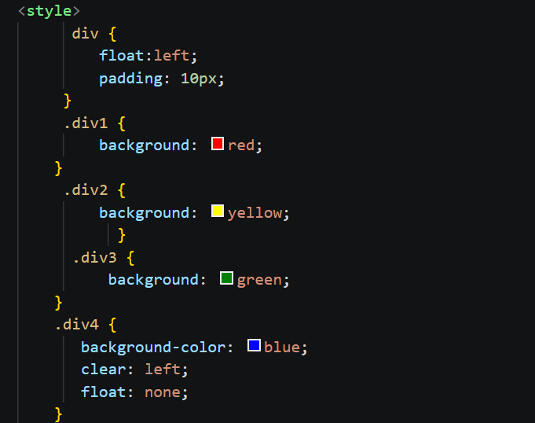
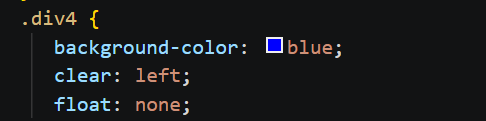
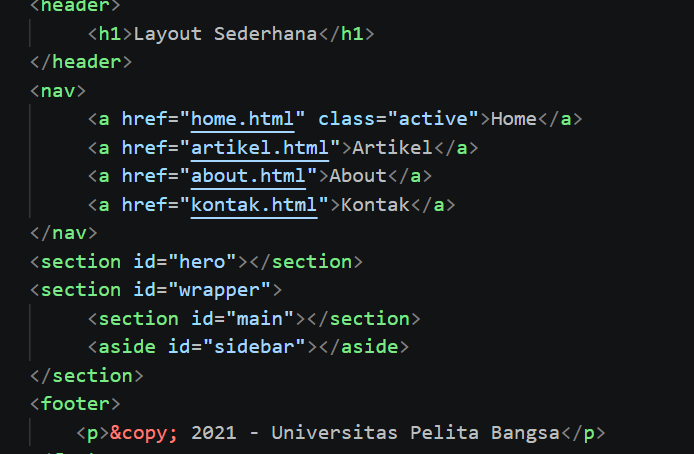
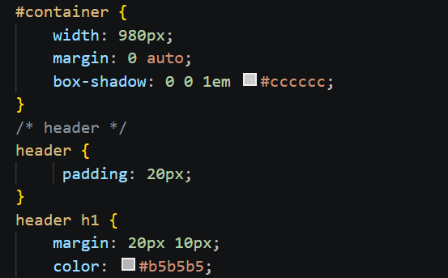
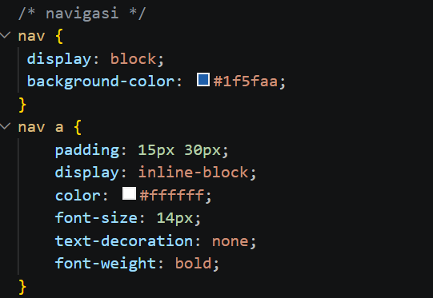
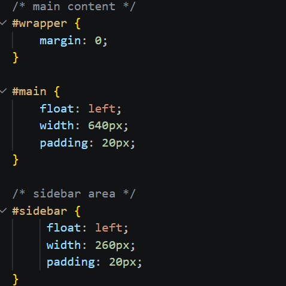
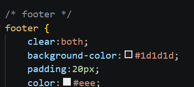

# Lab4_Box.Html
# Laporan Praktikum 4 — CSS Layout

## 1. Box Element
Mempelajari struktur box element pada HTML yang terdiri dari margin, border, padding, dan content.

## 2. Float Property
Menggunakan properti `float` untuk membuat elemen berjajar secara horizontal.

## 3. Clearfix Element
Menggunakan properti `clear` untuk mengatur posisi elemen setelah elemen float.

## 4. Layout Website Sederhana
Membuat kerangka website menggunakan header, navigasi, hero, konten utama, sidebar, dan footer.

## 5. Header dan CSS Layout
Mengatur ukuran dan tampilan header serta container menggunakan CSS.

## 6. Navigasi
Mengatur menu Home, Artikel, About, dan Kontak menggunakan CSS.

## 7. Hero Panel
Mengatur bagian hero yang berada di bawah navigasi website.

## 8. Main Content dan Sidebar
Mengatur posisi konten utama dan sidebar agar tersusun rapi.

## 9. Footer
Membuat bagian footer yang terletak di bawah halaman website.

## 10. Content Artikel
Menambahkan artikel yang berisi judul, gambar, dan paragraf.

## 11. Halaman About
Membuat halaman About yang berisi deskripsi diri dan portofolio.

## 12. Halaman Contact
Membuat halaman Contact yang berisi formulir nama, email, dan pesan.

**Hasil:**

**Hasil**

